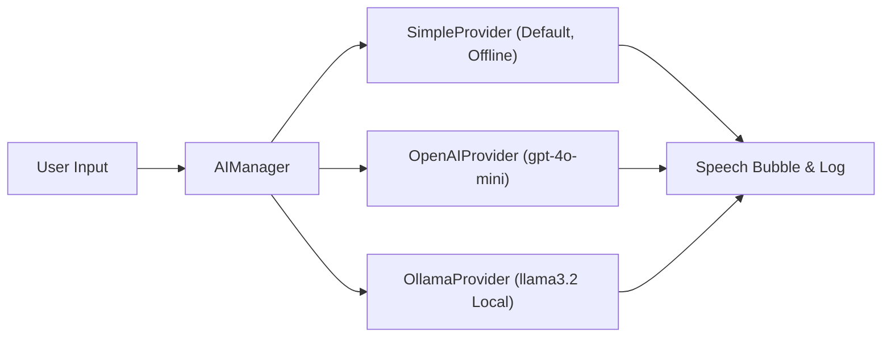

# Desktop AI Pet — Asha 💜

A cross-platform (Windows 10/11 + Ubuntu Linux) animated desktop companion built with **Python 3.10+ / 3.12+** and **PySide6 (Qt)**. The application features a floating transparent pet with AI conversation, offline speech capabilities, smart desktop awareness, proactive wellness reminders, custom sprite/outfit support, SQLite memory persistence, and an extensible plugin engine.

---

## 📑 Table of Contents
1. [Feature Summary](#feature-summary)
2. [Folder Structure](#folder-structure)
3. [Prerequisites & System Setup](#prerequisites--system-setup)
4. [Installation Process](#installation-process)
5. [Application Startup Process](#application-startup-process)
6. [AI Configuration Process](#ai-configuration-process)
7. [Voice & Speech Process (TTS / STT / Wake-Word)](#voice--speech-process-tts--stt--wake-word)
8. [User Interaction & Controls Process](#user-interaction--controls-process)
9. [Desktop Awareness & Proactive Reactions Process](#desktop-awareness--proactive-reactions-process)
10. [Message History & Export Process](#message-history--export-process)
11. [Adding Real Sprite Art & Outfits](#adding-real-sprite-art--outfits)
12. [Plugin Development Process](#plugin-development-process)
13. [Testing Process](#testing-process)
14. [Packaging & Distribution Process](#packaging--distribution-process)
15. [Troubleshooting & Platform Notes](#troubleshooting--platform-notes)

---

## Feature Summary

| Area | Features Implemented |
|---|---|
| **Window** | Frameless, transparent, always-on-top, draggable, hidden from taskbar, click-through mode, minimize to tray, auto-clamped on-screen position memory |
| **Animation** | 19 animation states (`idle`, `blink`, `walk`, `run`, `jump`, `sleep`, `talk`, `happy`, `sad`, `thinking`, `surprised`, `laugh`, `angry`, `wave`, `dance`, `sit`, `follow_cursor`, `stretch`, `celebrate`). Procedural chibi character with breathing, blinking, and dancing when sprite frames are not present |
| **AI Chat** | Switchable **Simple (offline/zero-dependency)**, **OpenAI**, or **Ollama (local)** backend, personality prompts, recent turn memory, SQLite relationship levels |
| **Voice** | Offline TTS (`pyttsx3`) with automatic female voice selection, STT (`SpeechRecognition` with PocketSphinx and Google Web fallback), wake-word listener ("hey asha") with ALSA noise suppression |
| **Desktop Awareness** | Active application tracking, idle time detection (via GNOME Mutter DBus & `xprintidle`), battery, network, CPU/RAM, and current date/time |
| **Smart Reactions** | Active app reactions (VS Code, Chrome, Firefox, Spotify, Terminal), idle break alerts, continuous typing compliments, welcome-back greetings, low battery alerts |
| **Screen Time** | Incremental active screen time tracking in SQLite with non-repeating milestones at 30 min, 1h, 2h, 3h+ |
| **Speech Bubble** | Typewriter text animation with auto-hide and automatic anchoring above the pet |
| **History Panel** | Searchable dialogue history, category filter, date presets (Today/Yesterday/7 Days/30 Days/All Time), and export to TXT, CSV, JSON |
| **Plugins** | Drop-in plugin architecture via `plugins/` leveraging the safe `PetAPI` facade (includes working `stretch_reminder` plugin) |
| **Packaging** | PyInstaller spec + Windows `.bat` and Linux `.sh` build scripts, `.desktop` launcher |
| **Automated Tests** | 40 unit and integration tests covering settings, database, animation state machines, AI fallbacks, and plugins |

---

## Folder Structure

```
DesktopAIPet/
├── main.py                        # Application entry point & lifecycle
├── requirements.txt               # Python package dependencies
├── README.md                      # Comprehensive documentation & process guide
│
├── config/
│   ├── settings.py                # Defaults: window, animation, AI, voice, awareness
│   ├── settings_manager.py        # Loads/saves settings to SQLite
│   └── character.json             # Character profile metadata
│
├── animations/
│   ├── animation_controller.py    # AnimationState enum, sprite frame loading, procedural chibi
│   ├── animation_manager.py       # Basic frame loader utility
│   └── state_machine.py           # PetState reference enum
│
├── ai/
│   ├── base_provider.py           # AIProvider ABC & ChatTurn dataclass
│   ├── simple_provider.py         # Default offline pattern/regex-based chat backend
│   ├── openai_provider.py         # OpenAI API chat backend (gpt-4o-mini)
│   ├── ollama_provider.py         # Local Ollama chat backend (llama3.2)
│   ├── ai_manager.py              # Personality, prompt builder, memory & provider switching
│   └── ai_worker.py               # Background QThread for non-blocking AI chat responses
│
├── voice/
│   ├── tts_engine.py              # pyttsx3 offline TTS with auto female-voice selector
│   ├── stt_engine.py              # SpeechRecognition STT with ALSA C-error suppression
│   └── wake_word.py               # Background listener for "hey asha" phrase
│
├── database/
│   ├── memory_db.py               # SQLite schema & persistence (preferences, history, messages)
│   └── asha_memory.db             # SQLite database file
│
├── system/
│   ├── activity_monitor.py        # System stats (CPU/RAM/battery/idle time/active app)
│   ├── reaction_engine.py         # Contextual triggers with per-event cooldowns
│   ├── message_generator.py       # Varied template generator with repeat-suppression buffer
│   ├── screen_time_tracker.py     # 30m / 1h / 2h / 3h+ milestone nudges
│   └── startup_manager.py         # OS autostart registration (Windows Registry / Linux .desktop)
│
├── ui/
│   ├── pet_window.py              # Main floating companion window + right-click context menu
│   ├── system_tray.py             # System tray icon & tray context menu
│   ├── speech_bubble.py           # Floating typewriter dialogue bubble
│   ├── chat_input.py              # Input popup with text field and push-to-talk mic button
│   ├── history_panel.py           # Dialogue archive dialog (search, filter, export, clear)
│   └── settings_dialog.py         # Configuration panel dialog
│
├── plugins/
│   ├── plugin_base.py             # AshaPlugin ABC & PetAPI facade
│   ├── plugin_manager.py          # Dynamic plugin discovery & loader
│   └── example_reminder_plugin.py # Sample plugin: 30-minute stretch reminder
│
├── utils/
│   ├── logger.py                  # Rotating logger (console + logs/asha.log)
│   └── history_export.py          # TXT, CSV, JSON export helpers
│
├── assets/
│   ├── icons/                     # tray_icon.png, tray_icon.jpeg
│   ├── characters/                # <outfit>/<state>/frame_XXXX.png sprite folders
│   ├── animations/                # Animation sequences
│   └── audio/                     # Audio clips and sound effects
│
├── packaging/
│   ├── asha.spec                  # PyInstaller configuration
│   ├── build_windows.bat          # Windows build script
│   ├── build_linux.sh             # Linux build script
│   └── asha.desktop               # Linux desktop entry file
│
└── tests/
    ├── conftest.py                # Fixtures (Headless QApplication, scratch DB)
    ├── test_settings.py           # Settings persistence tests
    ├── test_memory_db.py          # SQLite memory tests
    ├── test_ai_manager.py         # AI coordination & fallback tests
    ├── test_simple_provider.py    # Offline AI provider pattern tests
    ├── test_animation_controller.py# Animation states & procedural drawing tests
    ├── test_plugin_manager.py     # Plugin discovery & execution tests
    ├── test_message_generator.py  # Message variety & template tests
    ├── test_message_log.py        # History logging & filtering tests
    ├── test_screen_time_tracker.py# Screen time calculation tests
    ├── test_tts_engine.py         # Voice selection heuristic tests
    └── test_window_position.py    # Window position persistence tests
```

---

## Prerequisites & System Setup

### Linux (Ubuntu / Debian)
Install runtime system packages for audio, text-to-speech, microphone access, and window monitoring:
```bash
sudo apt update
sudo apt install -y python3-dev python3-venv espeak espeak-ng portaudio19-dev libasound2-dev xdotool dbus
```

### Windows (10 / 11)
- Python 3.10+ or 3.12+ (ensure **"Add Python to PATH"** is checked during installation).
- Built-in Windows SAPI5 handles TTS without additional packages.
- A functional microphone is required for STT features.

---

## Installation Process

1. **Clone or navigate to the repository:**
   ```bash
   git clone https://github.com/your-username/DesktopAIPet.git
   cd DesktopAIPet
   ```

2. **Create and activate a Python virtual environment:**
   - **Linux / macOS:**
     ```bash
     python3 -m venv .venv
     source .venv/bin/activate
     ```
   - **Windows:**
     ```cmd
     python -m venv .venv
     .venv\Scripts\activate
     ```

3. **Install dependencies:**
   ```bash
   pip install --upgrade pip
   pip install -r requirements.txt
   ```

---

## Application Startup Process

### Step 1: Launch Application
Run the main script:
```bash
python3 main.py
```

### Step 2: What Happens Under the Hood
1. `ensure_directories()` creates missing directory structures (`assets/`, `database/`, `logs/`, `plugins/`).
2. `QApplication` initializes with `setQuitOnLastWindowClosed(False)` so closing/hiding windows leaves the system tray process running.
3. `MemoryDB` initializes the SQLite database schema at `database/asha_memory.db`.
4. `SettingsManager` loads persisted settings and validates the last-known window coordinates against the primary screen geometry (auto-correcting any off-screen positions).
5. `PetWindow` is instantiated:
   - Configured with `Qt.FramelessWindowHint | Qt.WindowStaysOnTopHint | Qt.Tool` (stays above other windows and stays out of the taskbar).
   - Starts `AnimationController` (runs procedural chibi or disk frames).
   - Launches `ReactionEngine` (monitors applications and system stats).
   - Launches `ScreenTimeTracker` (polls active time every 30s).
   - Loads plugins from `plugins/` via `PluginManager`.
6. `SystemTray` icon is added to the system tray with a menu for show/hide, click-through toggles, and quit.
7. Asha greets the user with an introductory speech bubble and optional voice greeting.

---

## AI Configuration Process

Asha supports three switchable AI backends via **Right-click ➔ ⚙️ Settings ➔ Voice & AI**:



### Option A: Simple Provider (Default, Zero-Setup)
- Works immediately out-of-the-box with **no API keys, no local servers, and no internet**.
- Recognizes patterns like greetings ("hi", "namaste", "kem cho"), wellness ("tired", "sad", "happy"), identity queries, date/time queries, and jokes.

### Option B: Local Ollama (Free, Private, Offline LLM)
1. Install [Ollama](https://ollama.com).
2. Start the Ollama server:
   ```bash
   ollama serve
   ```
3. Pull the default model:
   ```bash
   ollama pull llama3.2
   ```
4. In Asha, open **Settings ➔ Voice & AI**, select **Ollama (local)**, and click **Save Settings**.

### Option C: OpenAI (Cloud LLM)
1. Set your OpenAI API key in your terminal/environment:
   ```bash
   export OPENAI_API_KEY="sk-your-openai-api-key"
   ```
2. In Asha, open **Settings ➔ Voice & AI**, select **OpenAI**, choose your model (`gpt-4o-mini`), and click **Save Settings**.

---

## Voice & Speech Process (TTS / STT / Wake-Word)

### 1. Offline Text-to-Speech (TTS)
- Handled by `TTSEngine` via `pyttsx3`.
- Executes speech in background threads so UI never freezes.
- Automatically selects female voice models based on voice metadata (e.g., Zira, Hazel, Samantha) or system defaults.
- Volume, speech rate, voice ID, and mute toggles are adjustable via Settings or context menu.

### 2. Speech-to-Text (STT)
- Handled by `STTEngine` via `SpeechRecognition`.
- Supports push-to-talk: open chat input via **Right-click ➔ 💬 Chat** and click the 🎙️ **Mic** button.
- Tries offline PocketSphinx first; falls back to Google Web Speech API when connected.
- Features automatic ALSA C-error suppression to prevent terminal noise on Linux.

### 3. Wake-Word Detection
- Listens for `"hey asha"` in the background when enabled in **Settings ➔ Voice & AI ➔ Enable wake word listener**.
- Once detected, Asha responds with `"Yes?"` and opens microphone listening automatically.

---

## User Interaction & Controls Process

| Action | Control | Description |
|---|---|---|
| **Move Character** | `Left-Click + Drag` | Moves the pet across any desktop screen. Position is auto-saved to SQLite. |
| **Open Context Menu** | `Right-Click Pet` | Opens the full control menu. |
| **Chat Dialog** | `Right-Click ➔ 💬 Chat` | Opens floating text box and voice recording button. |
| **Sleep / Wake** | `Right-Click ➔ 😴 Sleep` | Toggles sleeping animation and 'Zzz' particles. |
| **Dance** | `Right-Click ➔ 💃 Dance` | Triggers playful rhythmic sway animation. |
| **Change Outfit** | `Right-Click ➔ 👗 Change Outfit` | Cycles between: Casual, Formal, Winter, Festival, Night Suit, School, Traditional Indian. |
| **Click-Through Mode** | `Right-Click ➔ 🖱️ Click-through` | Makes pet transparent to mouse clicks (allows clicking behind the pet). |
| **Disable Click-Through** | `Tray Icon ➔ Disable Click-through` | Restores pet interactivity if click-through is enabled. |
| **Screen Time Check** | `Right-Click ➔ 📊 Screen Time` | Displays active computer time accumulated today. |
| **History Panel** | `Right-Click ➔ 🕘 History` | Opens message archive with search, filter, and export. |
| **Settings Panel** | `Right-Click ➔ ⚙️ Settings` | Adjusts AI, voice, themes, animation speed, and startup options. |
| **Mute / Unmute** | `Right-Click ➔ 🔇 Mute` | Instantly toggles speech audio on or off. |
| **Restart Application** | `Right-Click ➔ 🔄 Restart` | Relaunches application process cleanly. |
| **Exit** | `Right-Click ➔ ✖ Exit` | Stops background threads, saves state, and quits. |

---

## Desktop Awareness & Proactive Reactions Process

`ActivityMonitor` periodically samples desktop conditions every 5 seconds. `ReactionEngine` processes the snapshot and triggers contextual dialogue with cooldown throttling:

1. **Active Application Reactions**:
   - `Visual Studio / Code` ➔ *"Back to coding? 👩‍💻"* (Focus category)
   - `Chrome / Firefox / Edge` ➔ *"Research... or YouTube? 👀"* (General category)
   - `Spotify` ➔ *"Ooh, what are we listening to?"* (General category)
   - `Terminal` ➔ *"Living in the terminal today, huh?"* (Productivity category)
2. **Idle & Break Detection**:
   - Continuous idle for 5+ minutes (via GNOME Mutter DBus or `xprintidle`) ➔ *"Coffee break? ☕ I'll be here."* (Break Reminder category)
   - Returning after 1+ hour away ➔ *"Welcome back! Missed you. 💜"* (General category)
3. **Continuous Typing Streaks**:
   - Continuous typing activity for 90+ seconds triggers encouragement (e.g. *"Great focus today!"*).
4. **Screen Time Milestones**:
   - `ScreenTimeTracker` counts active seconds in SQLite. Contextual nudges fire at **30 minutes**, **1 hour**, **2 hours**, **3 hours**, and hourly thereafter.

---

## Message History & Export Process

Every line spoken by Asha is saved to the `messages` table in `database/asha_memory.db` with:
- Message text
- Category (`Health`, `Break Reminder`, `Screen Time`, `Focus`, `Compliment`, `Motivation`, `Productivity`, `Water Reminder`, `Exercise`, `General`)
- Timestamp (UTC ISO format)
- Screen time accumulated at moment of speech
- Character mood / animation state

### Exporting History:
1. Right-click Asha ➔ **🕘 History**.
2. Filter by category dropdown, search keyword, or timeline preset (Today, Yesterday, Last 7 Days, Last 30 Days, All Time).
3. Click **Export...** and choose:
   - **Text (`.txt`)**
   - **CSV (`.csv`)**
   - **JSON (`.json`)**

---

## Adding Real Sprite Art & Outfits

Asha has zero-code sprite loading. Drop PNG frames into the asset hierarchy:

```
assets/characters/<outfit_key>/<animation_state>/frame_0001.png
assets/characters/<outfit_key>/<animation_state>/frame_0002.png
...
```

### Supported Outfit Keys:
- `casual`
- `formal`
- `winter`
- `festival`
- `night_suit`
- `school`
- `traditional_indian`

### Supported Animation States:
`idle`, `blink`, `walk`, `run`, `jump`, `sleep`, `talk`, `happy`, `sad`, `thinking`, `surprised`, `laugh`, `angry`, `wave`, `dance`, `sit`, `follow_cursor`, `stretch`, `celebrate`.

*If no PNG frames are present for a given outfit/state, Asha automatically renders the procedural animated chibi character.*

---

## Plugin Development Process

Asha features an auto-discovery plugin architecture.

### Creating a New Plugin:
Create a new file in `plugins/`, e.g., `plugins/my_hydration_plugin.py`:

```python
from PySide6.QtCore import QTimer
from plugins.plugin_base import AshaPlugin, PetAPI

class HydrationReminderPlugin(AshaPlugin):
    name = "hydration_reminder"
    description = "Reminds the user to drink water every 45 minutes."

    def on_load(self) -> None:
        self.timer = QTimer()
        self.timer.timeout.connect(self._remind)
        self.timer.start(45 * 60 * 1000)  # 45 minutes

    def _remind(self) -> None:
        self.api.say("Time for a sip of water! 💧", category="Water Reminder")

    def on_unload(self) -> None:
        if hasattr(self, "timer"):
            self.timer.stop()
```

The plugin is automatically discovered, instantiated, and started on next application run.

---

## Testing Process

The project includes automated test coverage with **40 pytest test cases**:

### Run All Tests:
```bash
pytest tests/ -v
```

### Run Specific Test Suites:
```bash
# Test AI coordination and fallbacks
pytest tests/test_ai_manager.py -v

# Test SQLite memory and message persistence
pytest tests/test_memory_db.py tests/test_message_log.py -v

# Test window positioning boundaries
pytest tests/test_window_position.py -v

# Test animation states and controller
pytest tests/test_animation_controller.py -v

# Test plugin auto-discovery
pytest tests/test_plugin_manager.py -v
```

---

## Packaging & Distribution Process

Standalone executable distributions are built using **PyInstaller**:

### Build for Linux:
```bash
bash packaging/build_linux.sh
```
Output executable and bundled assets are created at `dist/Asha/`.

To install the Linux desktop launcher:
```bash
cp packaging/asha.desktop ~/.local/share/applications/
# Update Exec and Icon paths inside asha.desktop to your installation path
```

### Build for Windows:
```cmd
packaging\build_windows.bat
```
Output executable is created at `dist\Asha\Asha.exe`.

---

## Troubleshooting & Platform Notes

- **Linux / Wayland Window Opacity**: Wayland compositors manage window opacity at the compositor level. The application automatically bypasses client-side opacity calls under Wayland to eliminate platform warnings.
- **Off-Screen Recovery**: If external monitors are disconnected, `PetWindow` checks the primary screen available geometry on startup and automatically recenters itself to `(100, 100)` if saved coordinates are outside desktop bounds.
- **Click-Through Recovery**: If click-through mode is activated, mouse clicks pass through the pet to background apps. Right-click the **System Tray Icon** and choose **🖱️ Disable Click-through** to regain pet interaction.
- **ALSA Sound System Messages**: On Linux, PortAudio audio initialization messages are suppressed at the C-library level by `STTEngine` using a persistent global error handler callback.
- **Logs**: Application diagnostic logs are recorded with daily rotation in [`logs/asha.log`](file:///home/remotedevs2/Projects/DesktopAIPet/logs/asha.log).
